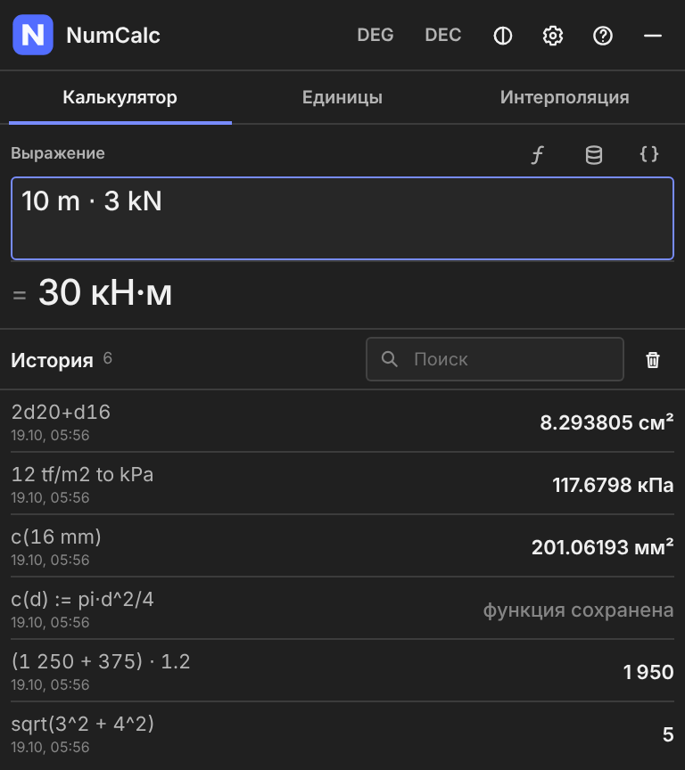
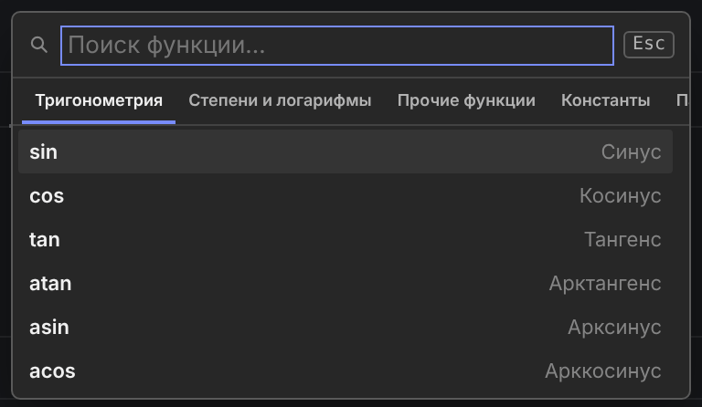
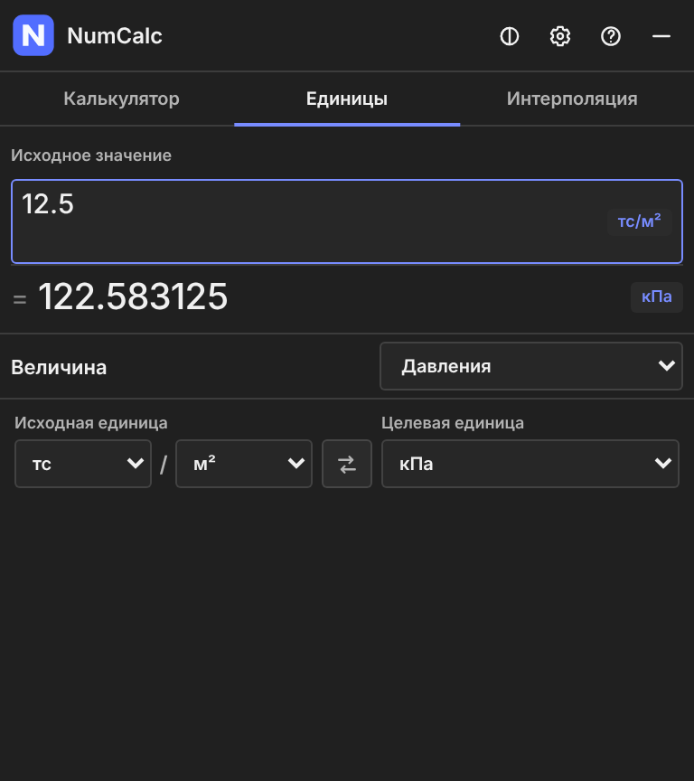
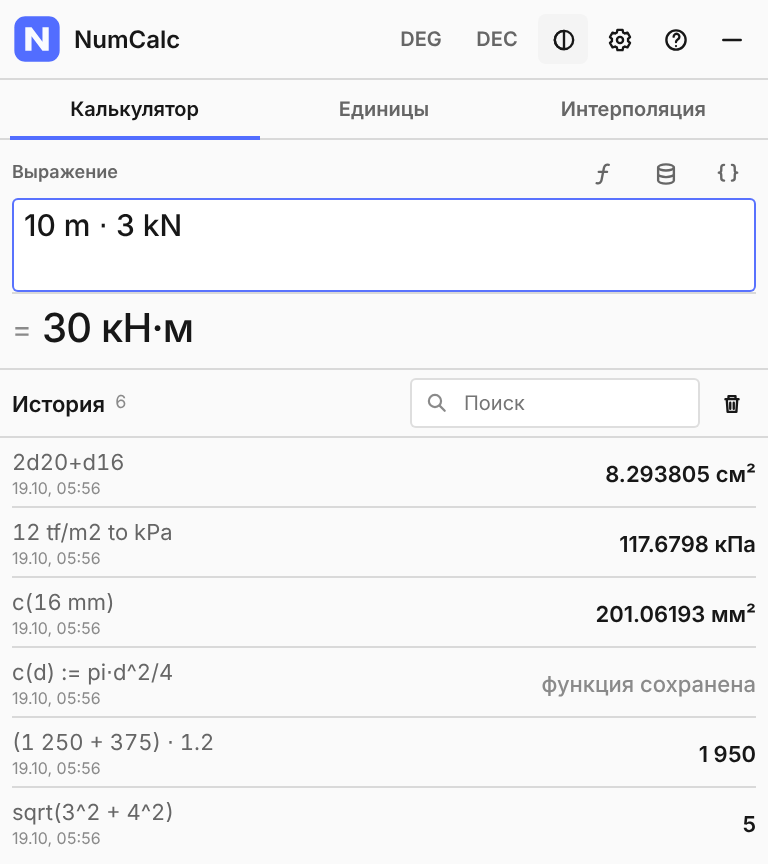
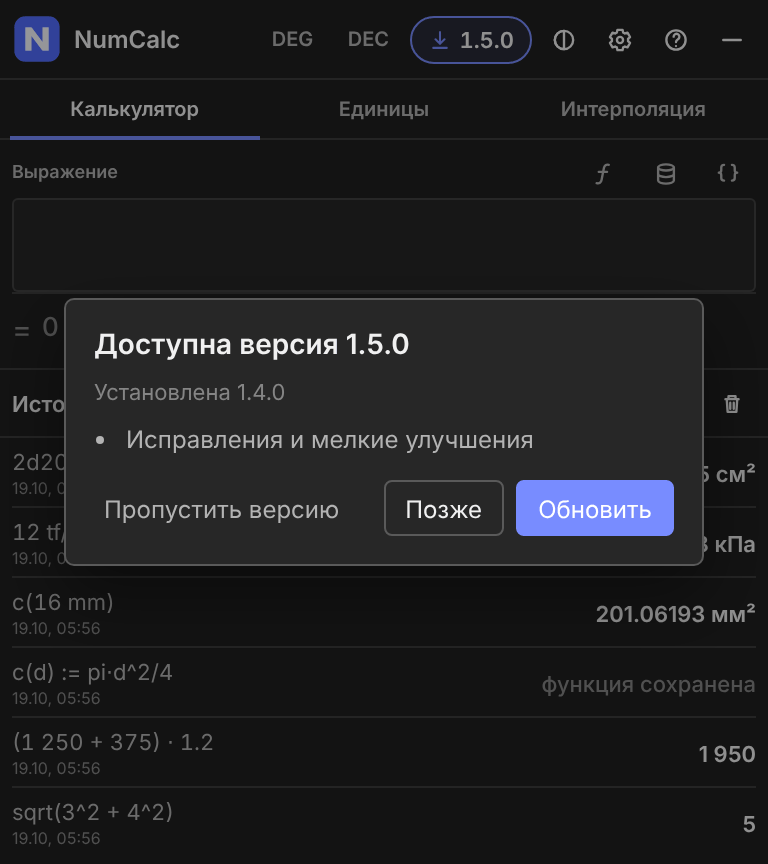

<p align="center">
  
</p>

<h1 align="center">NumCalc</h1>

<p align="center">
  Калькулятор для Windows, который всегда под рукой: нажали <b>NumLock</b> — посчитали — нажали ещё раз, и окно спряталось.
</p>

<p align="center">
  <a href="https://github.com/Aev199/numlock-calculator/releases/latest"><b>Скачать NumCalc 1.4.3</b></a>
  ·
  <a href="CHANGELOG.md">Что нового</a>
  ·
  <a href="https://github.com/Aev199/numlock-calculator/issues">Сообщить об ошибке</a>
</p>

---

**NumCalc 1.4.3** — идеологическое продолжение [NumLock Calculator](https://nlcalc.narod.ru/) Владимира Потапова. Это самостоятельный проект, а не официальная новая версия оригинала.

## Как пользоваться

Пишете выражение, как на бумаге. Результат виден сразу, Enter сохраняет его в историю и оставляет в строке, чтобы считать дальше.

```text
(1250 + 375) * 1.2        = 1 950
sqrt(3^2 + 4^2)           = 5
200 + 10%                 = 220
```

Все действия доступны с клавиатуры:

| Клавиша | Что делает |
|---|---|
| **NumLock** | показать или спрятать окно (клавишу можно сменить в настройках) |
| **Enter** | посчитать и записать в историю |
| **↑ / ↓** | пролистать прошлые выражения |
| **Tab** | список функций |
| **Ctrl+C** | скопировать выражение с ответом |
| **Alt+← / →** | переключить вкладки |
| **Esc** | закрыть подсказку, очистить строку или спрятать окно |

<p align="center">
  
</p>

## Для инженера

Единицы пишутся прямо в выражении, NumCalc сам приведёт их и подберёт удобную запись ответа:

```text
10 m * 3 kN               = 30 кН·м
12 tf/m2 to kPa           = 117.6798 кПа
2d20+d16                  = 8.293805 см²      площадь стержней
d16s150                   = 13.404129 см²/м   армирование с шагом 150 мм
```

Повторяющиеся расчёты удобно оформить своей функцией. Она сохранится и будет доступна в списке по Tab:

```text
c(d) := pi*d^2/4
c(16 mm)                  = 201.06193 мм²
```

Ещё есть переменные (`span := 6 m`), десять ячеек памяти, отдельная вкладка перевода единиц и линейная интерполяция по двум точкам.

<p align="center">
  
  &nbsp;
  
</p>

## Обновления

NumCalc сам проверяет, вышла ли новая версия, и показывает её номер в заголовке окна. Нажали «Обновить» — новая версия скачается, проверится и запустится после перезапуска. Если что-то не понравилось, в настройках есть кнопка «Вернуть предыдущую версию».

<p align="center">
  
</p>

Если на работе программам закрыт выход в интернет, есть два обходных пути:

- нажать «Скачать в браузере» — NumCalc сам найдёт скачанный файл в «Загрузках»;
- положить `NumCalc.exe` и `latest.json` из выпуска в общую сетевую папку и указать её в настройках. Чтобы не настраивать каждый компьютер, рядом с `NumCalc.exe` можно положить файл `numcalc-update.txt` с путём к этой папке.

## Установка

1. Скачайте `NumCalc-1.4.3-windows-x64.zip` со [страницы выпуска](https://github.com/Aev199/numlock-calculator/releases/latest).
2. Распакуйте в любую папку и запустите `NumCalc.exe`.

Устанавливать ничего не нужно. Работает на Windows 10 и 11 (нужен WebView2, в современных Windows он уже есть). Windows может предупредить о неизвестном издателе — это потому, что программа не подписана.

Окно закрывается в трей, полностью выйти можно через меню значка. Там же включается автозапуск.

Все данные хранятся только на вашем компьютере, в `%LOCALAPPDATA%\NumCalc`. Чтобы держать их рядом с программой, например на флешке, создайте рядом с `NumCalc.exe` пустой файл `portable.mode`.

## Для разработчиков

```bat
py -3 -m venv .venv
.venv\Scripts\python -m pip install -r requirements.txt
.venv\Scripts\python app_keyboard.py
```

Тесты — `python -m unittest discover -s tests`, сборка EXE — `build.bat`. Выпуск собирает workflow `release`: по тегу `vX.Y.Z` или ручным запуском с флажком «publish», который сам ставит тег по версии из `product_info.py`. Перед выпуском проходится [ручная проверка в Windows](docs/WINDOWS_ACCEPTANCE.md).

Код распространяется по лицензии [MIT](LICENSE), лицензии сторонних компонентов — в [THIRD_PARTY_NOTICES.md](THIRD_PARTY_NOTICES.md). Репозиторий: https://github.com/Aev199/numlock-calculator
